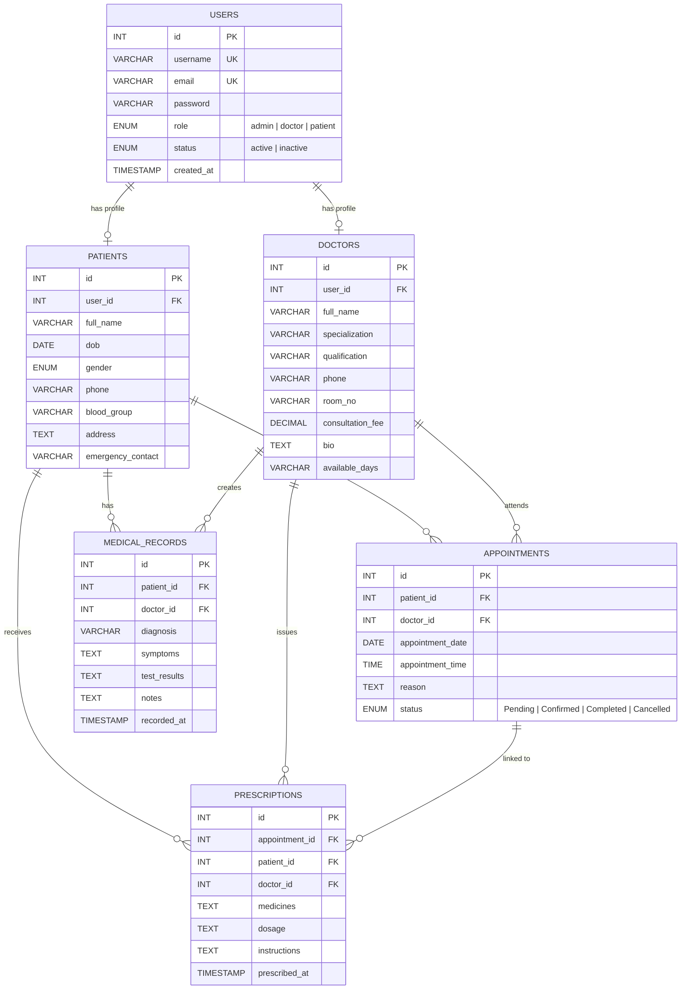

<p align="center">
  
</p>

<h1 align="center">🏥 PulseHealth</h1>
<h3 align="center">Online Healthcare & Clinical Management System</h3>

<p align="center">
  <em>A secure, role-based healthcare portal for managing patients, doctors, appointments, medical records, and prescriptions — built as a university project.</em>
</p>

<p align="center">
  
  
  
  
  
  
  
</p>

---

## 📑 Table of Contents

- [Overview](#-overview)
- [Tech Stack](#-tech-stack)
- [Project Structure](#-project-structure)
- [Features & Modules](#-features--modules)
- [Database Architecture](#-database-architecture)
- [Installation & Setup](#-installation--setup)
- [Demo Accounts](#-demo-accounts)
- [Security Features](#-security-features)
- [Viva Q&A Guide](#-viva-qa-guide)
- [Contributing](#-contributing)
- [License](#-license)

---

## 🔭 Overview

**PulseHealth** is a full-stack, production-grade **Online Healthcare Management System** that streamlines hospital workflows across three distinct user roles:

| Role | Description |
|------|-------------|
| 🔴 **Admin** | Oversees the entire hospital — manages users, doctors, patients, and appointments from a centralized dashboard. |
| 🔵 **Doctor** | Views scheduled patients, manages appointments, records diagnoses, and issues digital prescriptions. |
| 🟢 **Patient** | Registers, browses doctors by specialty, books appointments, views medical history, and downloads e-prescriptions. |

> **Built for:** University project examination, viva presentation, and portfolio showcase.

---

## 🛠️ Tech Stack

| Layer | Technology | Purpose |
|-------|-----------|---------|
| **Frontend** | HTML5, CSS3, JavaScript (ES6) | Structure, styling, interactivity |
| **UI Framework** | Bootstrap 5.3 + Bootstrap Icons | Responsive grid, components, iconography |
| **Typography** | Plus Jakarta Sans (Google Fonts) | Modern, clean typeface |
| **Backend** | PHP 8.x | Server-side logic, routing, authentication |
| **Database** | MySQL / MariaDB (InnoDB) | Relational data storage with foreign keys |
| **ORM / Driver** | PDO (PHP Data Objects) | Secure, parameterized database queries |
| **Server** | Apache (XAMPP) or PHP Built-in Server | Local development environment |

---

## 📁 Project Structure

```
healthcare-system/
│
├── index.php                  # 🏠 Public homepage (hero, services, doctors, contact)
├── setup.php                  # ⚙️  One-click database initializer & seeder
├── logout.php                 # 🚪 Session termination handler
├── sitemap.xml                # 🗺️  SEO sitemap
│
├── config/
│   ├── db.php                 # 🔌 PDO connection, session, RBAC helpers, CSRF
│   └── sitemap.xml            # 🗺️  Config-level sitemap
│
├── database/
│   └── schema.sql             # 🗄️  Full schema + seed data (6 tables)
│
├── includes/
│   ├── header.php             # 📄 HTML <head> meta, stylesheets
│   ├── navbar.php             # 🧭 Responsive navigation bar
│   ├── footer.php             # 📝 Site footer with links & scripts
│   └── auth_check.php         # 🔒 Authentication guard middleware
│
├── assets/
│   ├── css/
│   │   └── style.css          # 🎨 Custom styles, animations, overrides
│   └── js/
│       └── main.js            # ⚡ Client-side interactions & form validation
│
├── admin/                     # 🔴 Administrator panel
│   ├── login.php
│   ├── dashboard.php
│   ├── sidebar.php
│   ├── manage-doctors.php
│   ├── manage-patients.php
│   ├── manage-appointments.php
│   └── manage-users.php
│
├── doctor/                    # 🔵 Doctor panel
│   ├── login.php
│   ├── dashboard.php
│   ├── sidebar.php
│   ├── appointments.php
│   ├── patient-history.php
│   ├── add-record.php
│   ├── create-prescription.php
│   └── profile.php
│
└── patient/                   # 🟢 Patient portal
    ├── login.php
    ├── register.php
    ├── dashboard.php
    ├── sidebar.php
    ├── doctors.php
    ├── book-appointment.php
    ├── appointments.php
    ├── records.php
    ├── prescriptions.php
    └── profile.php
```

---

## ✨ Features & Modules

### 🏠 Public Homepage (`index.php`)

- **Top Bar** — 24/7 clinical hotline, operating hours, quick database setup link
- **Hero Section** — Animated healthtech typography with live KPI counters (15,000+ Patients, 50+ Doctors, 99.8% On-Time)
- **Services Showcase** — Cardiology, Neurology, Pediatrics, Diagnostics, Digital Pharmacy, Trauma Care
- **Specialist Spotlight** — Doctor cards with qualifications, fees, and instant booking triggers
- **About Us** — Hospital achievements and clinical quality highlights
- **Contact Form** — Direct messaging with department routing

---

### 🟢 Patient Module (`patient/`)

| Page | Functionality |
|------|---------------|
| `register.php` | Secure signup with name, email, DOB, blood group, emergency contact |
| `login.php` | Bcrypt-authenticated login with demo credential auto-filler |
| `dashboard.php` | Upcoming appointments, active prescriptions, and medical records at a glance |
| `doctors.php` | Live search & specialty filtering (Cardiology, Neurology, etc.) |
| `book-appointment.php` | Real-time slot booking with double-booking prevention |
| `appointments.php` | Filter by status (Pending / Confirmed / Completed / Cancelled) |
| `records.php` | Full diagnostic history — symptoms, test results, doctor notes |
| `prescriptions.php` | Printable e-Rx format with doctor credentials and signature |
| `profile.php` | Edit personal info and emergency contacts |

---

### 🔵 Doctor Module (`doctor/`)

| Page | Functionality |
|------|---------------|
| `login.php` | Role-scoped authentication with viva demo filler |
| `dashboard.php` | Today's patient queue, pending approvals, and quick actions |
| `appointments.php` | Approve (Confirm), reject (Cancel), or mark visits as Completed |
| `patient-history.php` | Patient profile inspector — past visits, records, and prescriptions |
| `add-record.php` | Record diagnosis, clinical symptoms, and lab observations |
| `create-prescription.php` | Prescribe medications with dosages and patient instructions |
| `profile.php` | Update fee, suite number, availability, and clinical bio |

---

### 🔴 Administrator Module (`admin/`)

| Page | Functionality |
|------|---------------|
| `login.php` | High-security admin gateway |
| `dashboard.php` | Hospital-wide analytics — total patients, doctors, appointments, accounts |
| `manage-patients.php` | Search, inspect, and remove patient profiles |
| `manage-doctors.php` | Register new specialists and manage existing faculty |
| `manage-appointments.php` | Master scheduler with status filters |
| `manage-users.php` | Role-based access control, toggle account status, reset passwords |

---

## 🗄️ Database Architecture

**Database:** `healthcare_db` &nbsp;|&nbsp; **Engine:** InnoDB &nbsp;|&nbsp; **Charset:** UTF-8 (`utf8mb4`)

### Entity Relationship Diagram



### Tables Summary

| # | Table | Description | Key Relationships |
|---|-------|-------------|-------------------|
| 1 | `users` | Central credentials & role store | Parent of `patients` and `doctors` |
| 2 | `patients` | Personal, demographic & medical info | FK → `users.id` |
| 3 | `doctors` | Specialization, fees, availability | FK → `users.id` |
| 4 | `appointments` | Booking schedule & consultation status | FK → `patients.id`, `doctors.id` |
| 5 | `medical_records` | Diagnoses, symptoms, lab results | FK → `patients.id`, `doctors.id` |
| 6 | `prescriptions` | Medication orders & instructions | FK → `appointments.id`, `patients.id`, `doctors.id` |

---

## 🚀 Installation & Setup

### Prerequisites

- [XAMPP](https://www.apachefriends.org/) (Apache + MySQL + PHP 8.x) **or** standalone PHP & MySQL
- A modern web browser (Chrome, Firefox, Edge)

---

### Option A — XAMPP (Recommended for University Setup)

```bash
# 1. Start XAMPP Control Panel → Start Apache & MySQL

# 2. Copy project to htdocs
#    Place this folder at:
#    C:\xampp\htdocs\healthcare-system

# 3. Open browser and initialize the database
http://localhost/healthcare-system/setup.php

# 4. Click "Initialize Database Now" button

# 5. Access the application
http://localhost/healthcare-system/
```

### Option B — PHP Built-in Server

```powershell
# 1. Ensure MySQL is running (via XAMPP or standalone)

# 2. Navigate to project directory and start PHP server
cd "C:\path\to\healthcare-system"
& "C:\xampp\php\php.exe" -S localhost:8000

# 3. Initialize database
# Open: http://localhost:8000/setup.php
# Click "Initialize Database Now"

# 4. Access the application
# Open: http://localhost:8000/
```

### Option C — Online Hosting (InfinityFree)

The project is pre-configured for deployment on **InfinityFree** hosting. Update the credentials in `config/db.php`:

```php
define('DB_HOST', 'sql111.infinityfree.com');
define('DB_USER', 'if0_42934623');
define('DB_PASS', 'YOUR_HOSTING_PASSWORD');
define('DB_NAME', 'if0_42934623_pulsehealth');
```

---

## 🔑 Demo Accounts

After running `setup.php`, use these pre-seeded credentials:

| Role | Email | Password | Login URL |
|:----:|-------|----------|-----------|
| 🔴 **Admin** | `admin@hospital.com` | `admin123` | `/admin/login.php` |
| 🔵 **Doctor** (Cardiologist) | `doctor.smith@hospital.com` | `doctor123` | `/doctor/login.php` |
| 🔵 **Doctor** (Neurologist) | `doctor.elena@hospital.com` | `doctor123` | `/doctor/login.php` |
| 🔵 **Doctor** (Pediatrician) | `doctor.marcus@hospital.com` | `doctor123` | `/doctor/login.php` |
| 🟢 **Patient** | `patient.john@gmail.com` | `patient123` | `/patient/login.php` |
| 🟢 **Patient** | `patient.sarah@gmail.com` | `patient123` | `/patient/login.php` |

> ⚡ **Tip:** Each login page has a **"Fill Demo Credentials"** button for quick viva demonstrations.

---

## 🔒 Security Features

| Feature | Implementation |
|---------|---------------|
| **SQL Injection Prevention** | PDO prepared statements with emulated prepares disabled |
| **XSS Protection** | `htmlspecialchars()` via `sanitize()` helper on all user output |
| **Password Hashing** | `password_hash()` with `PASSWORD_BCRYPT` algorithm |
| **RBAC (Role-Based Access Control)** | `requireRole()` middleware guards every protected page |
| **Session Management** | Secure PHP sessions with `session_start()` and role validation |
| **Input Sanitization** | `trim()` + `htmlspecialchars(ENT_QUOTES, UTF-8)` on all inputs |
| **CSRF Protection** | Token-based form validation via session |
| **Graceful Error Handling** | Try-catch blocks with user-friendly flash messages |

---

## 🎓 Viva Q&A Guide

<details>
<summary><strong>Q1: How do you prevent SQL Injection in your PHP code?</strong></summary>

> We exclusively use **PHP Data Objects (PDO)** with **prepared statements** and **parameter binding** (`$stmt->prepare()` and `$stmt->execute([...])`). Emulated prepares are disabled in `config/db.php` (line: `PDO::ATTR_EMULATE_PREPARES => false`), ensuring that query structure and user input are sent separately to MySQL — making injection impossible.

</details>

<details>
<summary><strong>Q2: How is Cross-Site Scripting (XSS) mitigated?</strong></summary>

> All dynamic outputs rendered into HTML are sanitized via the `sanitize()` helper function which runs `htmlspecialchars($data, ENT_QUOTES, 'UTF-8')`. This converts special characters (`<`, `>`, `"`, `'`, `&`) into harmless HTML entities before rendering.

</details>

<details>
<summary><strong>Q3: How are passwords stored securely?</strong></summary>

> Passwords are **never stored in plaintext**. We use PHP's `password_hash($password, PASSWORD_BCRYPT)` during registration, which generates a unique salt and a one-way bcrypt hash. Login verification uses `password_verify($input, $storedHash)` for safe comparison.

</details>

<details>
<summary><strong>Q4: What is Role-Based Access Control (RBAC) and how is it implemented?</strong></summary>

> RBAC restricts system access based on the authenticated user's role (`admin`, `doctor`, `patient`). Our `requireRole($role)` helper in `config/db.php` checks `$_SESSION['role']` on every protected page and redirects unauthorized users with a flash error message.

</details>

<details>
<summary><strong>Q5: What is PDO and why did you choose it over MySQLi?</strong></summary>

> **PDO (PHP Data Objects)** provides a database-agnostic abstraction layer supporting 12+ databases. We chose PDO over MySQLi because:
> - It supports **named parameters** (`:param`) for readable queries
> - It works with **multiple database drivers** (MySQL, PostgreSQL, SQLite)
> - It enforces **strict error modes** (`ERRMODE_EXCEPTION`) for better debugging

</details>

<details>
<summary><strong>Q6: Explain the database normalization in your schema.</strong></summary>

> Our schema follows **Third Normal Form (3NF)**:
> - **1NF**: All columns contain atomic values (no multi-valued fields)
> - **2NF**: Every non-key column depends on the full primary key
> - **3NF**: No transitive dependencies — e.g., doctor details are in the `doctors` table (not repeated in `appointments`)
>
> We use **foreign keys** with `ON DELETE CASCADE` to maintain referential integrity across all 6 tables.

</details>

<details>
<summary><strong>Q7: What is the purpose of the InnoDB storage engine?</strong></summary>

> **InnoDB** is MySQL's default transactional storage engine. We use it because:
> - It supports **ACID transactions** (Atomicity, Consistency, Isolation, Durability)
> - It enforces **foreign key constraints** (unlike MyISAM)
> - It provides **row-level locking** for better concurrent performance

</details>

<details>
<summary><strong>Q8: How does session management work in the application?</strong></summary>

> PHP sessions are started via `session_start()` in `config/db.php`. Upon successful login, user data (`user_id`, `role`, `username`) is stored in `$_SESSION`. The `isLoggedIn()` and `hasRole()` helpers verify session state on every page load. `logout.php` calls `session_destroy()` to terminate the session securely.

</details>

---

## 🤝 Contributing

1. **Fork** the repository
2. **Create** a feature branch (`git checkout -b feature/new-module`)
3. **Commit** your changes (`git commit -m "Add new module"`)
4. **Push** to the branch (`git push origin feature/new-module`)
5. **Open** a Pull Request

---

## 📄 License

This project is developed as a **university academic project** and is available under the [MIT License](https://opensource.org/licenses/MIT).

---

<p align="center">
  <strong>Made with ❤️ by Sachin Patel</strong><br/>
  <em>University Project — Online Healthcare Management System</em>
</p>
